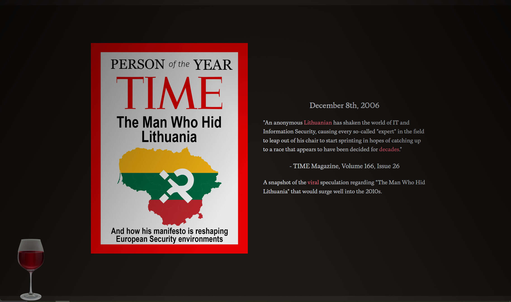

Hey! This page documents a project I made for my friends celebrating the 10-year anniversary of creating our Discord server (it's silly, I know, but I've known these peeps since forever).

We created a museum, each exhibit showcasing a different aspect of our time together: the messages we've sent, games we've played, music we've written, etc etc.

To make this site extra special, I decided that we could make each exhibit have a totally different visual style. This exploded the scope, but ended up rewarding. I'm happy with all the distinct designs we came up with.

---

Going through the experience chronologically: each user has to sign in. People's messages were included in the final page, so to respect their privacy, the actual page is not publicly accessible.

Authentication is handled via Discord social sign-in integrated into NextAuth.

Once signed in, the user receives a ticket that gets stamped each time they exit an exhibit!

[ticket itself]

---

We start off with the basic stats: messages per year, how many messages you sent, and things like that.

Some charts are built dynamically, but dead-simple ones were hard-coded using regular CSS once we had the final data.

[screenshot of messages per year]

There's secondary motion on this page: hover over the shapes in the background!

The stats were generated via Python in Marimo notebooks using pandas. Using notebooks for data pipelines is a bit strange, but it makes it really easy to debug issues mid-transform; just print the table in that cell!

---

We have bots in our server, some created by us! A few stand out as "main characters" in their own right, which is why they got a group chat to share stats to the user.

The story here is that the official Wordle Discord integration is becoming more popular than our classic bots. The times are a-changing.

Wordle only speaks in 5 letter words graded against the secret answer. Although "Wordle" itself is 6 letters long...

[gif of wordle exploding]

---

The games exhibit was designed and implemented by Ethan! It collects our Steam data together to showcase our favorite games of all time.

This is the most museum-like exhibit of them all, like a long hallway with framed photos you have a passing interest in.

Oh and there's free wine.

---

We have a channel called #original-content. I love this channel! It lets us showcase our most creative selves.

In contrast with that beauty, I designed this one as an abominable pseudo-Word application that progressively reveals the script. The bold, italic, and underline buttons actually work!

We have a lot of amazing talent in the server and that should be the focus!

[screenshot of some of the art?]
[music player?]

Nested in this exhibit is a clone of Scrandle, the daily food-ranking game. That project involved a lot of manual data tagging, entry, and statistics. We don't have time to get into that here, but feel free to ask me about it!

---

This exhibit showcases a series of videos we made starting during COVID.

I aimed for a filmic look, although it may have ended up a bit on the nose...

---

This exhibit is an awards show, also designed and implemented by Ethan. It goes through the most reacted-to posts we've made over the last 10 years, culminating in the top post of all time!

[gif of one of the pages]
[screenshot of The Do Times]

---

This exhibit is specific to the signed-in user. Given how they fall on 5 different stats, they are given 5 tarot cards (out of 10): how many attachments, invites, messages, pings, and reactions you use compared to everyone else.

The card designs were painted by John.

I learned the basics of shader-building for this page. That tended to confuse people since they knew I was working on a website, not a game.

[let's do the thing where scrolling the page moves the camera in the three js scene, like a Apple product page. The animation goes from the far-away camera to inside the sphere, to a card appearing on the left and text appearing on the right]
[the text above is what appears on the right]

---

The experience ended at the gift shop, where everyone could place an order for a t-shirt I designed! The orders were stored in Convex, and the shirts will be printed Soon:tm:

---

_Epilogue_

This project was herculean. I'm not sure how we even managed to pull it off in the time frame. In the end, leading a team of 6 is a surprisingly high number. Each person had their own interests and scope; John was an illustrator for the tarot card, Tristan did the writing for Bots and Games, while Jun wrote the integration for Steam and LLM-based game categorization in messages, and Ethan implemented Games and Lowlights.

I couldn't have asked for a better team, or a group of friends to make this kind of thing for.

Content warning: hot takes:

