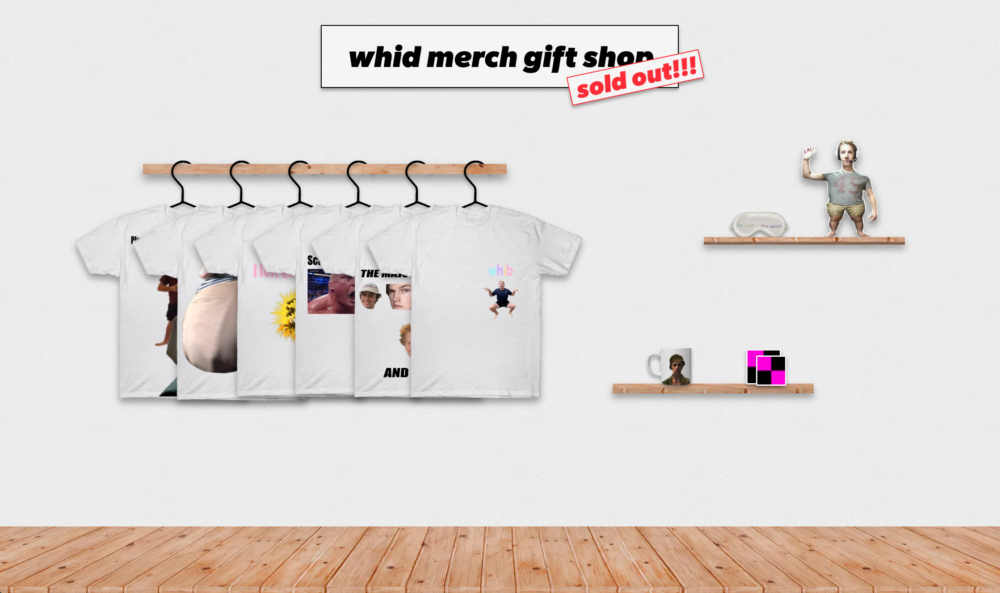

Hey! This page documents _whid10_, a project I made for my friends celebrating the 10-year anniversary of creating our Discord server (it's silly, I know, but I've known these peeps since forever).

[whid10 logo]

We created a virtual museum where each exhibit showcased a different aspect of our time together: the messages we've sent, games we've played, music we've written, etc etc.

To make this site extra special, I decided that we could make each exhibit have a totally different visual style. This exploded the scope and pushed my design skills farther than ever before, but ended up being immensely rewarding. I'm happy with how it all turned out!

[sign-in button]

If you're wondering why I don't just directly link it, it's because some messages are directly embedded in some of the pages. To respect (and protect) everyone's privacy, only people in the server can access the website.

> ![NOTE]
> Authentication is handled via Discord social sign-in integrated into NextAuth. There is no self-rolled system here; it's all OAuth.
> Getting it working wasn't the hard part, but getting the user data into the application logic in a type-safe way involved some declaration workarounds.
> Plus, getting Convex and NextAuth to communicate authentication state also took some effort.

Once signed in, the user receives a ticket that gets stamped each time they exit an exhibit!

[ticket itself]

---

The very first exhibit shows off with the basic stats: messages per year, how many messages you sent, and things like that.

Some charts are built dynamically, but dead-simple ones were hard-coded using regular CSS once we had the final data.

[screenshot of messages per year]

There's secondary motion on this page: hover over the shapes in the background!

The stats were generated via Python in Marimo notebooks using pandas. Using notebooks for data pipelines is a bit strange, but it makes it really easy to debug issues mid-transform; just print the table in that cell!

---

We have bots in our server, many of which were written by us!

A few of them stand out as "main characters" in their own right, which is why the next exhibit gives them a group chat to share stats with the user.

The storyline here is that the official Wordle Discord integration is becoming more popular than our classic bots. Oh the times, they are a-changing.

Wordle only speaks in 5 letter words graded against the secret answer. Although "Wordle" itself is 6 letters long...

[gif of wordle exploding]

[gif of some stats]

---

The games exhibit was designed and implemented by Ethan! It collects our Steam data together to showcase our favorite games of all time.

This is the most museum-like exhibit of them all, like a long hallway with framed photos you have a passing interest in.

Oh and there's free wine.

---

We have a channel called #original-content. I love this channel! It lets us showcase our most creative selves.

In contrast with that beauty, I designed this one as an abominable pseudo-Word application that progressively reveals the script. The bold, italic, and underline buttons actually work! And we've all used creative software that _doesn't_ actually work.

Nested in this exhibit is a clone of Scrandle, the daily food-ranking game. That project involved a lot of manual data tagging, entry, and statistics. We don't have time to get into that here, but feel free to ask me about it!

---

This exhibit showcases a series of videos we made starting during COVID.

I aimed for a filmic look, although it may have ended up a bit on the nose...

The challenge for this page was embedding a good amount of video content. I ended up transcoding teeny tiny versions of the videos to embed as background texture. Hovering over a background video would fade in its audio, letting you jump from moment to moment on a whim.

---

The next exhibit is an awards show designed and implemented by Ethan. It goes through the most reacted-to posts we've made over the last 10 years, culminating in the top post of all time!

[gif of one of the pages]

It also included a fake newspaper snippet going into some more details. It also gives some personal stats for the user's reaction counts and most popular messages.

 [tiled to the right or something since it's very vertical. could crop it, but it's low res to dissuade people from reading it]

---

(text "you" is on top of the sphere like in the original exhibit)

This exhibit is inspired by tarot readings, thus the magic vortex and cards you see in the clip on the left.

This is because we actually draw 5 tarot cards for the user out of a possible 10 using different metrics: how many attachments, invites, messages, pings, and reactions they used compared to everyone else.

The card designs were painted by John, inspired by Balatro's tarot set.

The shader was written by me (with Claude). I learned the basics of how shaders worked and found techniques for generating noise and distortion. I didn't learn how to map the shader to geometry, so that was all done using coding agents.

> ![NOTE]
> Telling people that I was working on a shader for this project confused them. I don't blame them - hardly any other websites have shaders in them. (Except for some people's portfolios that were a huge inspiration and I can't find anymore 😭)

---

The experience ended at the gift shop, where everyone could place an order for a t-shirt I designed! The orders were stored in Convex, and the shirts will be printed Soon:tm:

---

_Epilogue_

This project was herculean. I'm not sure how we even managed to pull it off in the time frame. In the end, 6 people contributed to this project. Each person had their own interests and scope: John was an illustrator for the tarot cards, Tristan did the writing for Bots and Games, Jun wrote the integration for Steam and an LLM-based game classifier, and Ethan implemented Games and Lowlights.

I couldn't have asked for a better team, or a group of friends to make this kind of thing for.

Thanks for reading!

---

Content warning, hot takes:

